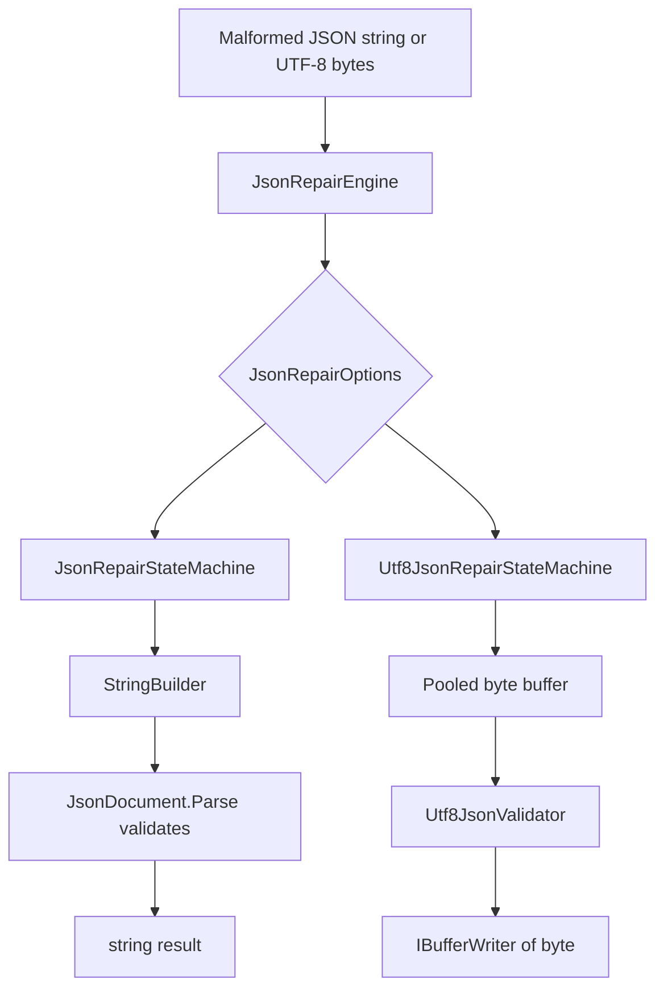

# JsonRepair.NET: Vision and Architecture Specification (.NET 10)

## 1. Vision Statement

**`JsonRepair.NET`** repairs malformed JSON for the .NET ecosystem so LLM and legacy payloads can be parsed with `System.Text.Json`.

Large Language Models frequently emit truncated or non-standard JSON: markdown fences, Python `None`/`True`/`False`, unquoted keys, single quotes, comments, or raw control characters. `System.Text.Json` rejects those inputs with `JsonException`.

`JsonRepair.NET` rewrites the syntax it knows how to repair into JSON that parses, and throws `JsonRepairException` when it cannot (0.2.0 valid-or-throw). It does not claim zero allocations on every API. The UTF-8 overload is the low-allocation path: the README measures **0 B/op** when the caller reuses the `IBufferWriter<byte>`. `Repair(string)` allocates the result string (896 B on the 83 B benchmark payload).

---

## 2. Architecture & Design Principles

### 2.1 Two Engines, Two Output Buffers

There is no `JsonCharBuffer` type and no `Repair(ReadOnlySpan<char>, Span<char>)` overload.

- **String engine.** `ref struct JsonRepairStateMachine` scans a `ReadOnlySpan<char>` and appends to a `StringBuilder`. The returned `string` is the allocation the string API cannot avoid.
- **UTF-8 engine.** `ref struct Utf8JsonRepairStateMachine` scans `ReadOnlySpan<byte>` and writes into a pooled staging buffer (`PooledBufferWriter` over `ArrayPool<byte>.Shared`). After `Utf8JsonValidator` accepts the bytes, they are copied to the caller's `IBufferWriter<byte>`. Nothing is written to that writer when repair fails.
- **Structure stack.** Both engines start from a `stackalloc` buffer of 64 elements and grow it with `ArrayPool<char>` or `ArrayPool<byte>`. That pool is the bracket stack, not the output.
- **`System.Text.Json` integration** is methods on `JsonRepairEngine`: `TryParse`, `Deserialize<T>`, and `TryDeserialize<T>`. There are no extension methods on `string`, `JsonDocument`, `JsonNode`, or `JsonSerializer`. Output is not produced with `Utf8JsonWriter`.

### 2.2 System Component Diagram



---

## 3. Supported Repair Scenarios

`JsonRepair.NET` handles these malformed-JSON patterns. Coverage against the josdejong corpus is the measured subset in [UPSTREAM.md](UPSTREAM.md), not this list alone.

1. **Markdown Code Fences**: Strips ` ```json ` and ` ``` ` headers/footers.
2. **Quote Normalization**: Converts single quotes `'key': 'value'` to double quotes `"key": "value"`.
3. **Unquoted Keys**: Wraps unquoted object keys (`{name: "Alice"}`) in double quotes (`{"name": "Alice"}`).
4. **Python & JS Literals**: Converts `None` → `null`, `True` → `true`, `False` → `false`, `undefined` → `null`, `NaN` → `null`. The same words in key position stay keys (`{None: 1}` → `{"None": 1}`).
5. **Trailing Commas**: Strips trailing commas in objects (`{"a": 1,}`) and arrays (`[1, 2,]`).
6. **Missing Commas**: Inserts missing commas between key-value pairs or array items (`{"a": 1 "b": 2}`).
7. **Unclosed Structures (Truncated JSON)**: Inserts missing `]`, `}`, and a closing quote for a truncated string (`{"message": "hello wor` → a closed string and object).
8. **Unescaped Control Characters**: Escapes raw newlines, carriage returns, tabs, backspace, and form-feed inside strings. **Unescaped double quotes inside strings are not repaired** (`{"text": "He said "hello""}` throws). That heuristic is planned for 0.3.0.
9. **Concatenated / Extra Content**: Removes leading or trailing commentary outside the primary JSON value.
10. **Comments**: Strips single-line (`// ...`) and multi-line (`/* ... */`) comments.

Empty or whitespace-only **strings** repair to `{}`. The JSON string `""` stays `""`. Whitespace-only UTF-8 throws instead of returning `{}`. Details are in [03-tdd-roadmap.md](03-tdd-roadmap.md) (TC19).

---

## 4. Public API Specification

Signatures match `src/JsonRepair/JsonRepairEngine.cs`.

```csharp
namespace JsonRepair;

public static class JsonRepairEngine
{
    public static string Repair(string json, JsonRepairOptions? options = null);

    public static void Repair(ReadOnlySpan<byte> utf8Input, IBufferWriter<byte> writer, JsonRepairOptions? options = null);

    public static bool TryRepair(string json, out string? repaired, JsonRepairOptions? options = null);

    public static bool TryRepair(ReadOnlySpan<byte> utf8Input, IBufferWriter<byte> writer, JsonRepairOptions? options = null);

    public static void Repair(ReadOnlySequence<byte> utf8Input, IBufferWriter<byte> writer, JsonRepairOptions? options = null);

    public static Task RepairAsync(Stream inputStream, Stream outputStream, JsonRepairOptions? options = null, CancellationToken cancellationToken = default);

    public static bool TryParse(string malformedJson, out JsonDocument? document, JsonRepairOptions? options = null);

    public static T? Deserialize<T>(string malformedJson, JsonRepairOptions? options = null, JsonSerializerOptions? jsonSerializerOptions = null);

    public static bool TryDeserialize<T>(string malformedJson, out T? result, JsonRepairOptions? options = null, JsonSerializerOptions? jsonSerializerOptions = null);
}
```

`Repair` throws `JsonRepairException` when the input cannot be turned into JSON that parses. The `Try*` methods return `false` instead. Multi-segment sequences and `RepairAsync` copy into a contiguous buffer and call the UTF-8 span overload, so they share that contract.
