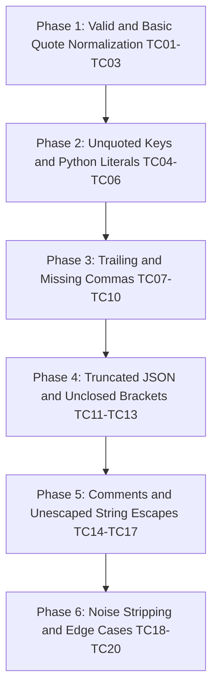

# JsonRepair.NET: TDD Test Suite & Matrix (.NET 10)

## Overview

This Test-Driven Development (TDD) roadmap defines the matrix of edge-case repairs for **`JsonRepair.NET`**. Statuses below were checked against the current engines and against `tests/JsonRepair.Tests/TestCases/JsonEdgeCaseData.cs` (driven by `RepairEngineTests.Repair_ShouldProduceValidJson_ForKnownEdgeCases`).

Testing stack:

- **`xUnit`** 2.9.3
- **`AwesomeAssertions`** 9.6.0 (Apache-2.0). The suite used to reference FluentAssertions; that package was replaced because FluentAssertions 8.x is under a non-commercial community licence. See `CHANGELOG.md` `[Unreleased]`.

The edge-case test compares with `JsonElement.DeepEquals`. The **Expected Output** column is that semantic target, not a byte-for-byte formatting contract. `Repair(string)` compacts most whitespace and can leave a space before a comma it inserts (`{"a":1 ,"b":2}`, `[1 ,2 ,3]`, `{"a":1 }`). The UTF-8 engine emits the compact form without that space. Both parse as the JSON in the expected column.

Cases marked **tested** are rows in `JsonEdgeCaseData`. Cases marked **works, not in the data set** were run against both engines for this doc pass and are not regression-locked.

---

## TDD Test Case Matrix

| ID | Test Category | Input Example | Expected Output | Status |
| :--- | :--- | :--- | :--- | :--- |
| **TC01** | Standard Valid JSON | `{"name": "John", "age": 30}` | `{"name": "John", "age": 30}` | Implemented, tested |
| **TC02** | Markdown Fences | ```json\n{"a": 1}\n``` | `{"a": 1}` | Implemented, tested |
| **TC03** | Single Quotes (Keys & Values) | `{'key': 'value'}` | `{"key": "value"}` | Implemented, tested |
| **TC04** | Unquoted Keys | `{foo: "bar", age: 25}` | `{"foo": "bar", "age": 25}` | Implemented, tested |
| **TC05** | Python Literals (`None`, `True`, `False`) | `{"active": True, "data": None}` | `{"active": true, "data": null}` | Implemented, tested (the data row also includes `"flag": False`) |
| **TC06** | JS Literals (`undefined`, `NaN`) | `{"val": undefined, "num": NaN}` | `{"val": null, "num": null}` | Implemented, tested |
| **TC07** | Trailing Commas in Objects | `{"a": 1, "b": 2,}` | `{"a": 1, "b": 2}` | Implemented, tested |
| **TC08** | Trailing Commas in Arrays | `[1, 2, 3,]` | `[1, 2, 3]` | Implemented, tested |
| **TC09** | Missing Commas in Objects | `{"a": 1 "b": 2}` | `{"a": 1, "b": 2}` | Implemented, tested |
| **TC10** | Missing Commas in Arrays | `[1 2 3]` | `[1, 2, 3]` | Implemented, tested |
| **TC11** | Unclosed Array (Truncated) | `[1, 2, 3` | `[1, 2, 3]` | Implemented, tested |
| **TC12** | Unclosed Object (Truncated) | `{"a": 1, "b": {"c": 2` | `{"a": 1, "b": {"c": 2}}` | Implemented, tested |
| **TC13** | Truncated String Value | `{"message": "hello wor` | `{"message": "hello wor"}` | Works on both engines (string closes, then the object closes). **Not in `JsonEdgeCaseData`.** |
| **TC14** | Single-line Comments | `{"a": 1 // comment\n}` | `{"a": 1}` | Implemented, tested |
| **TC15** | Multi-line Comments | `{"a": /* note */ 1}` | `{"a": 1}` | Implemented, tested |
| **TC16** | Unescaped Newlines in Strings | raw newline inside a string: `{"text": "line1<LF>line2"}` | `{"text": "line1\nline2"}` | Works on both engines. A raw CR+LF inside the string is written as the JSON escapes `\\r\\n`. **Not in `JsonEdgeCaseData`.** |
| **TC17** | Unescaped Double Quotes in Strings | `{"text": "He said "hello""}` | `{"text": "He said \"hello\""}` | **Planned for 0.3.0** (unescaped-quote heuristics). Today both engines throw `JsonRepairException` (`',' is invalid after a property name`). |
| **TC18** | Leading / Trailing Noise Text | `Here is the JSON: {"a": 1} Hope it helps!` | `{"a": 1}` | Implemented, tested (the data row uses `Here is the repaired JSON: {"a": 1} Enjoy!`; the sentence above also repairs) |
| **TC19** | Empty Input / Whitespace | empty string, or whitespace only (` `, `\t`, `\n`) | `{}` | `Repair(string)` returns `{}`, including `null` (`string.IsNullOrWhiteSpace`). **Not in `JsonEdgeCaseData`.** The JSON string `""` is a different input and correctly stays `""` on both engines (whitespace around it, `  ""  `, also stays `""`). Whitespace-only **UTF-8** does not return `{}`: the byte engine throws `JsonRepairException` (`the repaired output is empty`). An empty UTF-8 span does return `{}`. |
| **TC20** | Mixed Special Character Escapes | `{'path': 'C:\\Users\\test'}` | `{"path": "C:\\Users\\test"}` | Implemented, tested |

### Additional cases in `JsonEdgeCaseData` (TC21–TC34)

These were added with the 0.1.0/0.2.0 fixes. All of them are implemented and tested. Semantic expectations:

| ID | Test Category | Input Example | Expected Output | Status |
| :--- | :--- | :--- | :--- | :--- |
| **TC21** | Scientific notation preserved | `{"val": 1.2e-3, "big": 1E+10}` | `{"val": 1.2e-3, "big": 1E+10}` | Implemented, tested |
| **TC22** | Raw backspace and form-feed inside a string | `{"text": "line1<BS>line2<FF>"}` | `{"text": "line1\bline2\f"}` | Implemented, tested |
| **TC23** | `None` in key position is a key, not `null` | `{None: 1}` | `{"None": 1}` | Implemented, tested |
| **TC24** | `True` in key position is a key, not `true` | `{True: 'yes'}` | `{"True": "yes"}` | Implemented, tested |
| **TC25** | `None` in value position | `{a: None}` | `{"a": null}` | Implemented, tested |
| **TC26** | Mismatched closer on an object | `{"a": 1]` | `{"a": 1}` | Implemented, tested |
| **TC27** | Mismatched closer on an array | `[1, 2}` | `[1, 2]` | Implemented, tested |
| **TC28** | Mismatched empty structure | `{]` | `{}` | Implemented, tested |
| **TC29** | Nested mismatched closer | `{"a": [1, 2}` | `{"a": [1, 2]}` | Implemented, tested |
| **TC30** | Missing comma before a literal | `[1 None]` | `[1, null]` | Implemented, tested |
| **TC31** | `[` inside a string is content | `"["` | `"["` | Implemented, tested |
| **TC32** | `{` inside a string is content | `"{"` | `"{"` | Implemented, tested |
| **TC33** | Trailing comma inside a string is content | `"[1,2,3,]"` | `"[1,2,3,]"` | Implemented, tested |
| **TC34** | Leading prose before an object | `Here is your JSON: {"a": 1}` | `{"a": 1}` | Implemented, tested |

---

## TDD Implementation Order



TC01–TC16 and TC18–TC34 behave as the tables describe. TC17 is the open item in this matrix and is scheduled with the other unescaped-quote heuristics in [05-pre-1.0-roadmap.md](05-pre-1.0-roadmap.md) (0.3.0). The live release plan is that document, not this matrix.
