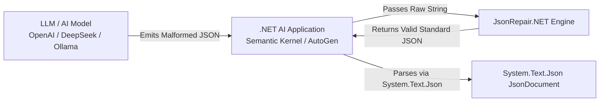
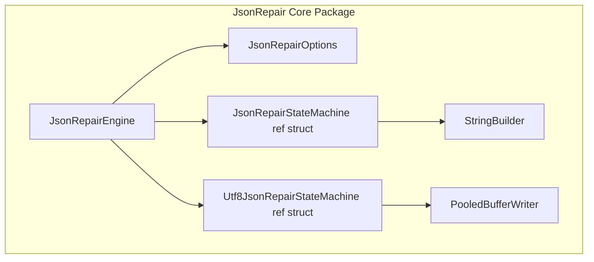
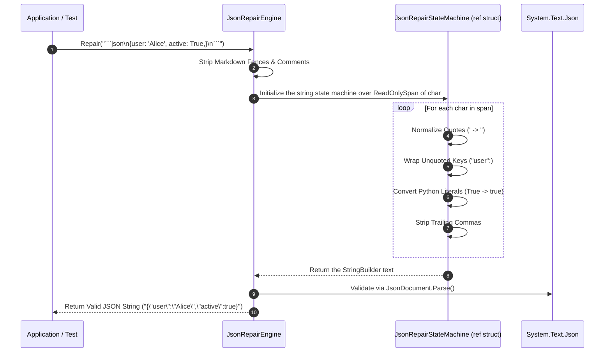
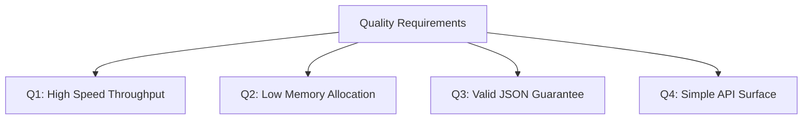

# arc42 Software Architecture Document: JsonRepair.NET

**System Name**: `JsonRepair.NET`  
**Target Framework**: `.NET 10` (`net10.0`)  
**License**: `MIT License`  
**Author**: Bifteki Crew  

---

## 1. Introduction and Goals

`JsonRepair.NET` is a C# library that repairs malformed, truncated, or non-standard JSON generated by Large Language Models (LLMs) and legacy systems into JSON that `System.Text.Json` accepts. Zero per-call allocation is a property of the UTF-8 API only, and only when the caller reuses the output writer (measured 0 B/op in the README). `Repair(string)` allocates its result string.

### 1.1 Requirements Overview
- **LLM Output Tolerance**: Handle Markdown code fences (` ```json `), single-quoted strings, unquoted keys, Python/JS literals (`None`, `True`, `False`, `undefined`, `NaN`), trailing commas, raw control characters inside strings (newline, tab, and the other escapes the engines already emit), and truncated unclosed objects, arrays, and strings. Unescaped quotes inside strings are not repaired yet (0.3.0).
- **Allocation**: The string engine scans `ReadOnlySpan<char>` with a `ref struct` and writes a `StringBuilder`. The UTF-8 engine scans bytes and stages output in a pooled `ArrayPool<byte>` buffer. `Utf8JsonWriter` is not on the output path.
- **Integration**: `TryParse`, `Deserialize<T>`, and `TryDeserialize<T>` are methods on `JsonRepairEngine`. There are no extension methods on `string`, `JsonDocument`, `JsonNode`, or `JsonSerializer`.

### 1.2 Quality Goals

| Goal | Description | Metric / Target |
| :--- | :--- | :--- |
| **QG1: Throughput & Speed** | Process malformed JSON with a single-pass state machine | Self-measured in the README (string vs UTF-8, three payload sizes). A 10×–50× advantage over regex or Python was a design target and has not been measured; the benchmark project does not include those comparisons. |
| **QG2: Zero Allocation** | UTF-8 span path allocates nothing per call, at any payload size | 0 B per op, measured. The 0.2.0 valid-or-throw contract needs a staging buffer so partially-repaired output never reaches the caller's writer; it is pooled and reused per thread rather than allocated per call |
| **QG3: Correctness & Safety** | Produce strictly valid JSON parseable by `System.Text.Json` | 100% test pass rate across edge-case matrix |
| **QG4: Zero Core Dependencies** | Core `JsonRepair` library has zero external 3rd-party dependencies | Clean standard library dependency tree |

### 1.3 Stakeholders

| Role | Expectation |
| :--- | :--- |
| **.NET AI Application Developers** | Reliable JSON repair for Semantic Kernel, AutoGen, and LLM API calls without runtime crashes. |
| **Library Maintainers** | Modular state machine architecture with clear TDD and ADR tracking. |

---

## 2. Architecture Constraints

- **Language & Runtime**: C# 13 / .NET 10 (`net10.0`).
- **Core Library Dependencies**: Zero 3rd-party dependencies (`System.Text.Json` and standard BCL only).
- **License**: MIT License (Permissive & Commercial-friendly).

---

## 3. Context and Scope

### 3.1 Business Context



### 3.2 Technical Context
`JsonRepair.NET` receives a `string` or UTF-8 bytes (`ReadOnlySpan<byte>`, `ReadOnlySequence<byte>`, or `Stream`) and returns a repaired `string` or writes UTF-8 into an `IBufferWriter<byte>`. There is no `Repair(ReadOnlySpan<char>, Span<char>)` overload.

---

## 4. Solution Strategy

1. **Two State Machines**: Avoid regex or string splitting. `JsonRepairStateMachine` scans `ReadOnlySpan<char>` into a `StringBuilder`. `Utf8JsonRepairStateMachine` scans UTF-8 bytes into a pooled buffer, then into the caller's `IBufferWriter<byte>`. There is no `JsonCharBuffer`.
2. **Layered Pipeline**:
   - *Phase 1 (Pre-processing)*: Strip Markdown code blocks (` ```json `) and comments (`//`, `/* */`).
   - *Phase 2 (State Machine Pass)*: Single-pass token scanner normalizing quotes, unquoted keys, Python literals, and missing commas.
   - *Phase 3 (Structure Balancer)*: Maintain a lightweight stack to automatically close unclosed `{` and `[` for truncated JSON.

---

## 5. Building Block View

### 5.1 Whitebox Overall System (Level 1)



#### Level 1 Component Descriptions
- **`JsonRepairEngine`**: The static facade exposing `Repair()` / `TryRepair()` over `string`, `ReadOnlySpan<byte>`, `ReadOnlySequence<byte>` and `Stream`, plus `TryParse()`, `Deserialize<T>()` and `TryDeserialize<T>()`.
- **`JsonRepairException`**: Thrown when input cannot be repaired into valid JSON. Derives from `JsonException` so existing catch clauses keep working.
- **`JsonRepairOptions`**: Configuration record toggling specific repair rules (markdown fence stripping, unquoted-key quoting, structure auto-closing, comment stripping, literal conversion).
- **`JsonRepairStateMachine`**: `ref struct` over `ReadOnlySpan<char>`. Appends repaired text to a `StringBuilder`.
- **`Utf8JsonRepairStateMachine`**: `ref struct` over UTF-8 bytes. Writes into `PooledBufferWriter`; the engine copies those bytes to the caller only after validation.

---

## 6. Runtime View

### 6.1 Repair Execution Sequence



---

## 7. Deployment View

- **NuGet Package**: `JsonRepair` published to NuGet.org targeting `net10.0`. Current package version is 0.2.0 (published 2026-08-29).
- **Demo CLI**: `src/JsonRepair.Cli` is not a global tool and is not packable (`IsPackable=false`). It runs a hardcoded Spectre.Console sample via `dotnet run --project src/JsonRepair.Cli`. A stdin/stdout `dotnet tool` is deferred to 0.5.0+.

---

## 8. Cross-cutting Concepts

### 8.1 Memory Management & Allocation Strategy
- The bracket stack is a `stackalloc` buffer of 64 elements, grown with `ArrayPool<char>.Shared` (string engine) or `ArrayPool<byte>.Shared` (UTF-8 engine). It is not the output buffer, and it is not capped at 256 characters.
- String output is a `StringBuilder`. `Repair(string)` therefore allocates in proportion to the input.
- UTF-8 output is staged in `PooledBufferWriter` (`ArrayPool<byte>.Shared`), validated, then copied to the caller's `IBufferWriter<byte>`. The README measures 0 B/op for that path when the caller reuses the writer. The rented array is returned after the call.
- The `ref struct` engines are not boxed. That does not make `Repair(string)` allocation-free.

### 8.2 Error Handling & Resilience
- **Valid-or-throw contract (0.2.0)**: `Repair` validates its own output before returning it. Either the caller receives JSON that parses, or a `JsonRepairException` is thrown. Best-effort text that fails later inside the caller's deserializer is no longer a possible outcome.
- **Nothing partial escapes**: the UTF-8 path stages into a pooled buffer and copies to the caller's `IBufferWriter<byte>` only after validation, so a rejected repair writes nothing. The `ReadOnlySequence` and `Stream` overloads delegate to the span path, so the contract has no back doors.
- **`Try*` Pattern**: `TryRepair`, `TryParse` and `TryDeserialize<T>` give the same guarantee exception-free, for high-throughput endpoints.
- **Error positions are output-relative**: the engine repairs optimistically and validates afterwards, so the only offsets available describe the repaired output, not the caller's input. They are therefore kept off the message and left on `InnerException`. Input-relative positions require the grammar-based rework scheduled for 0.3.0.

---

## 9. Architecture Decisions (ADRs)

### ADR-01: Use `ref struct` State Machine instead of Regular Expressions
- **Context**: Legacy JSON repair tools rely on multi-pass regex replacements.
- **Decision**: Implement a custom span-based state machine.
- **Consequences**: No regex catastrophic backtracking. Heap traffic is not zero on every API: `Repair(string)` allocates the result string, and the UTF-8 path measures 0 B/op only because its staging buffer is pooled (see the README). A 10×–50× speedup versus regex or Python implementations has not been measured.

### ADR-03: Validate Before Returning, Rather Than Repair Best-Effort
- **Context**: Through 0.1.0 `Repair` returned whatever the state machine produced. For unrepairable input that was invalid JSON, so the failure surfaced later at the caller's `Deserialize` call with a message pointing at the wrong thing. Worse, some inputs produced *valid* JSON that misrepresented the input.
- **Decision**: Validate the repaired output and throw `JsonRepairException` when it does not parse. Accept a staging buffer on the UTF-8 path so nothing partial reaches the caller.
- **Consequences**: Failure surfaces at the call that caused it. Repair categories the engine cannot yet handle now throw instead of returning something broken, which is visible as a lower reported parity number against upstream — an honest one. The staging buffer is pooled and reused per thread, so the guarantee costs no per-call allocation.

### ADR-02: Zero External Dependencies for Core Package
- **Context**: Minimizing supply-chain vulnerability and dependency conflicts for consumer applications.
- **Decision**: Keep `JsonRepair` library dependent only on the standard .NET BCL.
- **Consequences**: Lightweight assembly (<50 KB), zero transitive dependency conflicts.

---

## 10. Quality Requirements



---

## 11. Risks and Technical Debt

| Risk | Mitigation | Status |
| :--- | :--- | :--- |
| **Deeply Nested Malformed JSON** | Growable `ArrayPool`-backed stack in both engines; validators use an unbounded `MaxDepth` so they cannot reject output the engine can produce | Implemented & Tested |
| **Unquoted string values** | Unquoted keys are quoted. Unquoted values such as `{a: hello}` are not repaired; both engines throw. 69 josdejong corpus cases, scheduled for 0.3.0 | Open |
| **Engine divergence** | Two independent implementations can drift. A fuzz invariant fails the build on disagreements it generates, outside the recorded cases (root-level trailing comma; non-ASCII whitespace; whitespace-only UTF-8 throws while `Repair(string)` returns `{}`) — see [UPSTREAM.md](UPSTREAM.md) | Monitored |
| **Upstream parity gap** | 191/427 of the ported josdejong corpus passes; all 242 gaps categorised and ratcheted so the baseline can only shrink | Tracked, Tiers 3–4 |
| **Arm64 large-payload inversion** | Past ~100 KB the UTF-8 path measures ~20% slower than the `string` API on Apple Silicon, but faster on x64. Reproducible, unexplained | Open, needs profiling |

---

## 12. Glossary

- **LLM**: Large Language Model (e.g. GPT-4, Claude, DeepSeek).
- **SOUP**: Software of Unknown Provenance (3rd party libraries like Spectre.Console, BenchmarkDotNet).
- **Ref Struct**: A C# stack-only data structure that cannot be boxed or placed on the GC heap.
- **Span / ReadOnlySpan**: A type-safe and memory-safe representation of a contiguous region of arbitrary memory.
